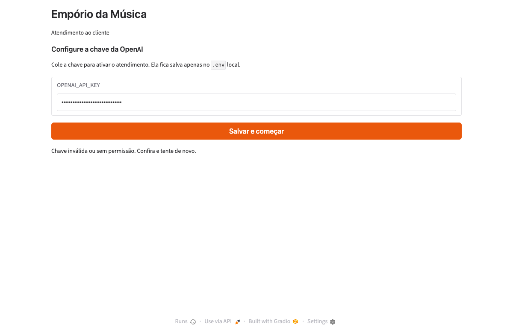
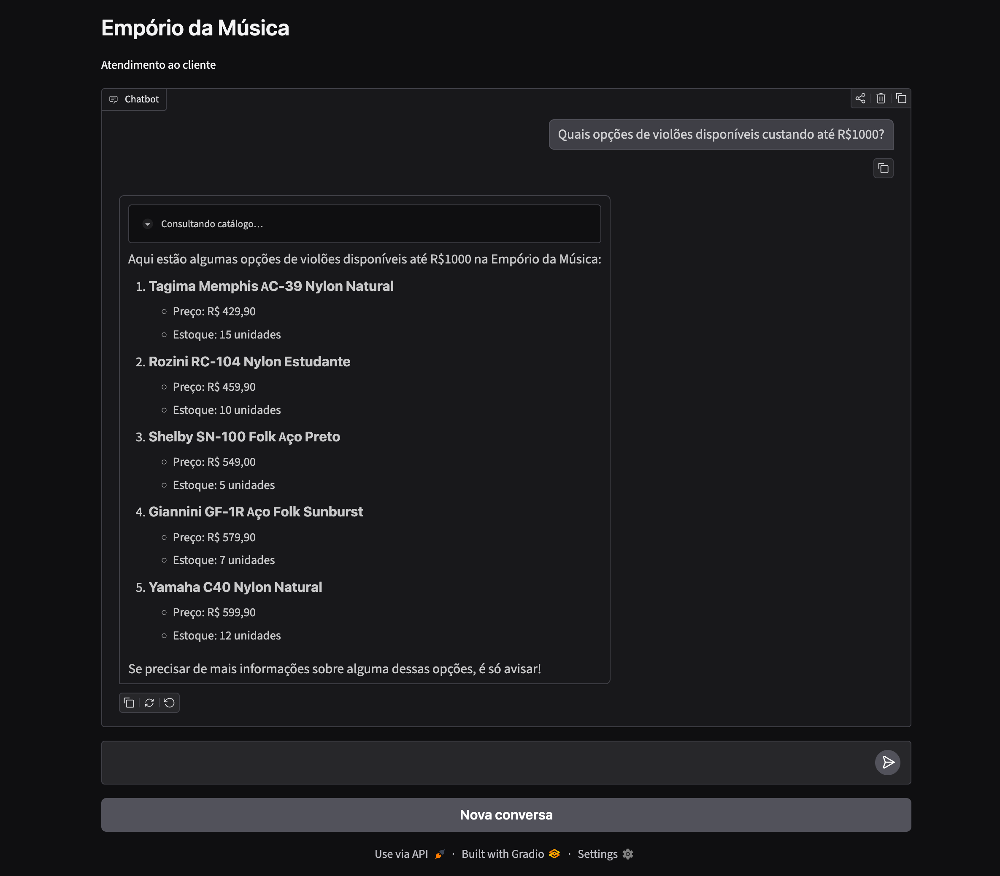
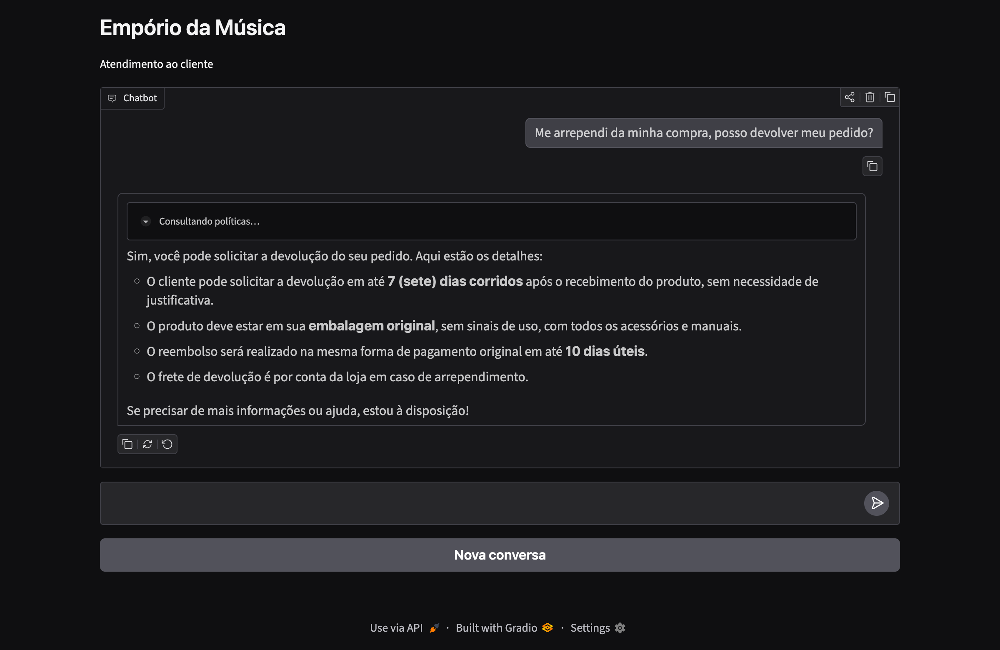
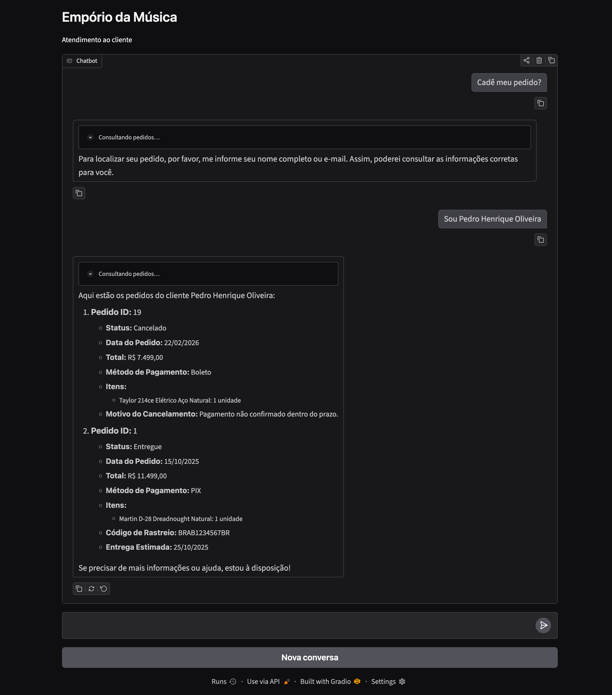
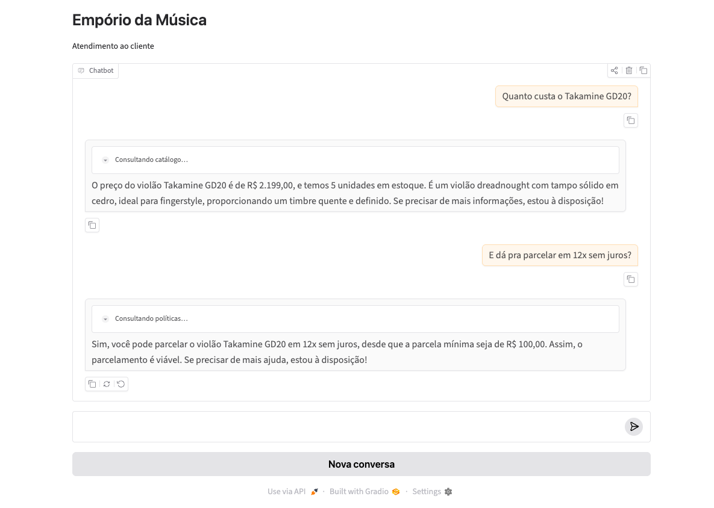
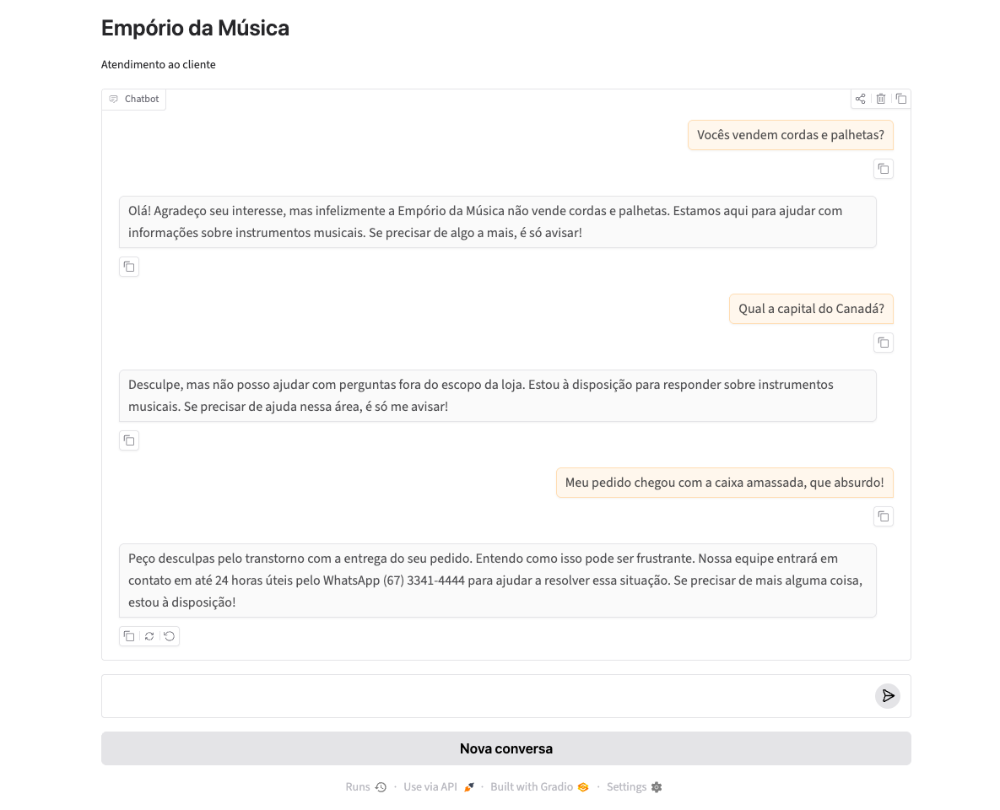

# Empório da Música — Agente de Atendimento Virtual

Agente de atendimento ao cliente de uma loja de instrumentos musicais fictícia (Campo Grande/MS), feito para o desafio técnico de AI Engineer da Artefact. Ele responde, em português, sobre **catálogo, preço, estoque e promoções**, **políticas da loja** (trocas, pagamento, frete, garantia, horários) e **status de pedidos**, e recusa com cordialidade o que está fora do escopo.

A decisão central do desafio, saber quando consultar **dados** e quando consultar **políticas**, é explícita na interface: cada consulta aparece como um bloco recolhível ("Consultando catálogo…", "Consultando políticas…", "Consultando pedidos…").

## Prova de funcionamento

Capturas da UI rodando o agente real (`gpt-4o-mini`) em 2026-11-05, sem edição das respostas. Os fatos de cada resposta foram conferidos contra os CSVs e o PDF; as mesmas perguntas estão automatizadas na bateria de eval (`uv run pytest -m eval`).

| O desafio pede | Evidência |
|---|---|
| Consultar **dados** (disponibilidade, preço) | [1](#1-catálogo-filtro-por-categoria-e-preço) violões até R$ 1.000 com estoque; [4](#4-memória-da-conversa-dado-e-política-na-mesma-conversa) preço do Takamine GD20 |
| Consultar **políticas** (troca, pagamento) | [2](#2-política-de-devolução-por-arrependimento) devolução por arrependimento; [4](#4-memória-da-conversa-dado-e-política-na-mesma-conversa) parcelamento |
| Saber **quando** usar cada fonte | blocos "Consultando catálogo…", "Consultando políticas…", "Consultando pedidos…" em 1 a 4 |
| Status de pedido | [3](#3-pedido-identificação-antes-de-expor-dados) identificação por nome antes de mostrar pedidos, com motivo do cancelamento |
| **Fora do escopo** e **persona** | [5](#5-acessórios-fora-do-escopo-e-reclamação) acessórios, pergunta alheia à loja, reclamação com prazo de retorno |
| Situação **não trivial** | [2](#2-política-de-devolução-por-arrependimento) regra do manual aplicada; [4](#4-memória-da-conversa-dado-e-política-na-mesma-conversa) "e dá pra parcelar?" resolvido pelo contexto da mensagem anterior |
| Configuração do provedor sem editar arquivos | [0](#0-configuração-da-chave-no-primeiro-acesso) tela de chave, com validação |

#### 0. Configuração da chave no primeiro acesso

Sem `OPENAI_API_KEY`, o app abre nesta tela. A chave é validada na OpenAI antes de ser gravada; aqui, uma chave inválida de demonstração.



#### 1. Catálogo: filtro por categoria e preço

"Violões até R$ 1.000" vira filtro SQL (categoria, preço, estoque > 0). Os cinco produtos, preços e estoques são os do `products.csv`.



#### 2. Política de devolução por arrependimento

Resposta tirada da seção 4.1 do manual: 7 dias corridos, embalagem original, reembolso em até 10 dias úteis, frete de devolução pago pela loja.



#### 3. Pedido: identificação antes de expor dados

O agente pede nome completo ou e-mail (nunca telefone) e só então lista os pedidos: #19 cancelado por pagamento não confirmado e #1 entregue com rastreio BRAB1234567BR.



#### 4. Memória da conversa: dado e política na mesma conversa

A segunda pergunta não repete o produto; o agente usa o histórico (checkpointer SQLite) e aplica a regra de parcela mínima de R$ 100.



#### 5. Acessórios, fora do escopo e reclamação

A loja só vende instrumentos; pergunta alheia recebe recusa cordial; reclamação recebe empatia e o prazo de retorno de 24 horas úteis.



## Como rodar

Você precisa de uma chave da API da OpenAI (enviada por e-mail pelo autor). Ela é colada na tela de configuração do app no primeiro acesso: não é preciso editar arquivos.

### Opção A — Docker (recomendada)

```bash
git clone <url-do-repositorio> && cd <repositorio>
docker compose up --build -d
```

Abra <http://localhost:7860>, cole a chave e clique em **Salvar e começar**. O app valida a chave, grava no `.env` local do container, prepara os dados (CSVs no SQLite e manual de políticas no índice vetorial) e libera o chat.

Se já existir um `.env` com `OPENAI_API_KEY` na pasta do projeto, o compose o usa e a tela de configuração é pulada.

### Opção B — Local

Requer Python 3.11+ e [uv](https://docs.astral.sh/uv/).

```bash
uv sync
uv run python -m app          # http://127.0.0.1:7860
```

A chave pode ser colada na tela inicial ou colocada antes em um `.env` (`cp .env.example .env`).

### Variáveis de ambiente

| Variável | Padrão | Função |
|---|---|---|
| `OPENAI_API_KEY` | — | Chave da OpenAI (também configurável pela UI) |
| `OPENAI_MODEL` | `gpt-4o-mini` | Modelo de chat |
| `RAG_MIN_SCORE` | `0.30` | Similaridade mínima para um trecho do manual ser usado |

### Testes

```bash
uv run pytest            # testes unitários, offline (ingestão, tools, UI, prompts)
uv run pytest -m eval    # bateria contra o agente real (usa a chave; gasta centavos)
```

Roteiro manual de validação: [`specs/001-store-qa-agent/quickstart.md`](specs/001-store-qa-agent/quickstart.md). Conversas de exemplo: [`examples/`](examples/).

## Arquitetura

```
Gradio (app/)  ──►  Dispatcher (create_agent, persona + regras)
                       │  4 tools-roteadoras, uma por especialista
        ┌──────────────┼───────────────┬────────────────┐
     catálogo       políticas        pedidos         atendimento
   search_products  search_policies  find_customer   (sem tools de dados:
   get_product_     get_store_info   list_customer_   persona, escopo,
   details              │             orders          reclamações)
        │               │                │
   SQLite (somente   ChromaDB          SQLite (somente
   leitura)          (manual em PDF)   leitura)

Memória da conversa: AsyncSqliteSaver (um thread_id por conversa)
```

- `agent/` — dispatcher (`graph.py`, `prompt.py`), especialistas (`specialists/`), tools (`tools/`), ingestão (`ingest.py`, `policies_rag.py`).
- `app/` — UI Gradio e fluxo de configuração da chave.
- `data/source/` — os 6 CSVs e o PDF do desafio; `data/runtime/` é gerado (SQLite, índice vetorial, checkpoints) e fica fora do git.
- `docs/adrs/` — decisões arquiteturais; `docs/learning-lessons/` — falhas e achados; `specs/` — spec, plano, tarefas e contratos.

## Decisões técnicas e por quê

**Framework: `langchain.agents.create_agent` sobre o runtime LangGraph.** Um agente com tool calling cobre o problema sem o peso de um harness maior. O `deepagents` foi avaliado e descartado: planejamento, filesystem virtual, subagentes e shell não têm uso neste domínio e seriam superfície a podar ([ADR-0003](docs/adrs/0003-right-sizing-harness.md)). O LangGraph dá o checkpointer e o `langgraph.json`, que permite subir o mesmo grafo no Agent Server oficial se a escala exigir.

**Dispatcher + especialistas ([ADR-0004](docs/adrs/0004-arquitetura-dispatcher.md)).** Um roteador leve delega a especialistas de domínio, um por user story, cada um com prompt e tools próprios e testável isoladamente. Torna o roteamento dados-vs-políticas visível na UI. O custo é real: cada pergunta passa por dois modelos (roteador e especialista) e o roteador reescreve a resposta, o que soma latência e tokens.

**LLM: OpenAI `gpt-4o-mini`.** Tool calling maduro e custo baixo por conversa. A chave é colada na tela inicial, validada na OpenAI antes de ser gravada no `.env` local (permissão 0600), mascarada no `repr` das configurações e nunca aparece em logs nem em mensagens de erro ([ADR-0006](docs/adrs/0006-chave-openai-pela-ui-gravada-no-env.md)).

**Retrieval híbrido ([ADR-0002](docs/adrs/0002-arquitetura-hibrida-tools-rag.md)).** Dados tabulares (preço, estoque, pedidos) vão por function calling sobre SQLite aberto somente para leitura: filtros e contas exatos, sem depender de embedding. Texto livre (o manual de políticas) vai por RAG: chunking por seção numerada do manual, título da seção embutido no vetor, IDs determinísticos, limiar mínimo de similaridade e sinal explícito de recuperação fraca para o agente declarar o limite em vez de improvisar. Embeddings `text-embedding-3-small` em espaço cosseno: nas 12 perguntas de política da bateria a seção correta ficou no top-3 em 12/12, contra 8/12 do modelo padrão do Chroma, que é em inglês ([ADR-0005](docs/adrs/0005-embeddings-openai-no-indice-de-politicas.md)).

**Estratégia de prompt.** O roteador tem as regras duras (nunca inventar preço/estoque, nada de ações transacionais, recusa de fora de escopo) e é obrigado a delegar; perguntas mistas acionam todos os especialistas envolvidos. Cada especialista tem regras do seu domínio (promoção sempre com preço original, percentual e preço final; citar o manual literalmente; identificar o cliente por nome completo ou e-mail antes de mostrar pedidos). As regras são verificadas por testes de marcadores nos prompts e, principalmente, pela bateria de eval.

**Persistência e deploy ([ADR-0001](docs/adrs/0001-runtime-single-container.md)).** Um único processo e um único container: UI, agente e `AsyncSqliteSaver` juntos. Para um avaliador isso significa uma chave, um comando e nenhum Postgres/Redis a subir. O SQLite e o índice vetorial são derivados dos CSVs e do PDF e reconstruídos a cada inicialização, então um volume antigo nunca serve dados de versão anterior ([ADR-0007](docs/adrs/0007-dados-de-runtime-reconstruidos-a-cada-start.md)).

## Qualidade e o que a avaliação revelou

O desenvolvimento seguiu TDD, e o critério de aceite é a bateria contra o agente real ([ADR-0008](docs/adrs/0008-bateria-de-eval-com-llm-real-como-aceite.md)). Os testes unitários rodam offline (`uv run pytest`). A bateria de eval (`uv run pytest -m eval`) roda as perguntas-ouro do quickstart contra o agente real, com asserções de fatos-chave, resposta em até 30 s e cenários de acompanhamento com referência anafórica.

Resultado na versão final: **43 de 43 casos** (11 de catálogo, 12 de políticas, 14 de pedidos, perguntas mistas, acompanhamento multi-turno e cenários da spec, e 6 de persona e escopo), cada resposta em até 30 s, em 3 min 39 s. O número varia entre execuções: em versões sucessivas do código, com correções entre elas, as rodadas completas desta fase deram 41/43, 40/43 e 43/43, com falhas em casos diferentes a cada vez (variação do `gpt-4o-mini`). Por isso os casos de fronteira foram medidos 10 vezes cada, e o que ficou abaixo de 9/10 virou correção com teste: Black Friday inativa (8/10 para 10/10, regra de primeira frase no especialista de catálogo), parcelamento no preço de um produto (8/10 para 10/10, o dispatcher passou a chamar políticas sempre que a mensagem citar pagamento) e `get_product_details` que não aceitava "ukulele Kalani KAL-700T" (a categoria antes do modelo; defeito da tool, 7/10 para 10/10 no especialista). Os demais casos de fronteira medidos ficaram em 10/10 (reclamação com prazo de 24 h, arrependimento, troca por defeito, troca por preferência, desconto no PIX, parcelamento, baixo descontinuado).

Uma exceção conhecida: na pergunta "se eu comprar no PIX, ganho mais 5% em cima da promoção?", o agente omite a regra de não cumulatividade em cerca de 1 de cada 5 execuções (14 de 18 medidas): às vezes o dispatcher responde só com o catálogo, sem consultar políticas. O caso continua na bateria e pode falhar numa rodada.

Fluxo do avaliador validado a partir de um clone limpo (sem `.env`): `docker compose up --build`, onboarding da chave e primeira resposta em 26 s com cache de camadas; o build a frio levou cerca de 2 minutos.

A primeira execução da bateria, com todos os testes unitários verdes, falhou em 11 de 36 casos. As causas, registradas em [LL-0002](docs/learning-lessons/0002-eval-do-quickstart-revelou-roteamento-e-recuperacao.md): o roteador respondendo sozinho em vez de delegar, embeddings em inglês, produto descontinuado invisível ao agente, filtro de categoria que não tolerava "violao" e itens de pedido com quantidade errada ("7 unidades" num pedido de 1). Todas foram corrigidas com teste. Esta última teve o diagnóstico corrigido na validação final: a causa não era o modelo, e sim a ingestão duplicando `order_items` a cada start do app. A lição prática: testes unitários não substituem avaliar o agente de ponta a ponta.

## Limitações conhecidas

- **Identificação do cliente é só uma regra de prompt.** O agente pede nome completo ou e-mail, mas a tool `list_customer_orders` aceita qualquer `customer_id`, sem vínculo com o cliente que se identificou, e a busca por nome é por trecho (mínimo de 3 letras, no máximo 5 candidatos). Quem souber o nome de outra pessoa vê os pedidos dela, e uma mensagem forjada para o modelo (prompt injection) poderia pedir pedidos por ID. A busca devolve só nome e cidade para minimizar exposição, mas isso não é autenticação.
- **Sem controle de acesso à configuração da chave.** Quem alcança a porta 7860 pode trocar a chave, inclusive pela API do Gradio mesmo com a tela já oculta. Por isso o `docker-compose.yml` publica a porta só em `127.0.0.1`; para expor em rede seria preciso autenticação.
- **Sem limite de taxa nem de gasto.** Qualquer um que use a interface consome a chave da OpenAI, sem teto por sessão.
- **Dependências com avisos conhecidos, não alcançáveis aqui.** `pip-audit` aponta avisos no Pillow (transitivo do Gradio, o app não recebe imagens) e no chromadb (carregamento remoto de modelos e autorização do modo servidor; o app usa o cliente embarcado). Devem ser atualizados quando houver versão corrigida.
- **Imagem Docker roda como root e sem `HEALTHCHECK`.** Aceitável para uma demonstração local.
- **Retenção ilimitada.** Os checkpoints de conversa ficam no SQLite sem expiração nem rotina de limpeza, e guardam o que o cliente escreveu.
- **Pensado para uma conversa por vez.** Cada conversa tem seu próprio `thread_id`, mas não houve teste de carga ou de concorrência alta; SQLite e um único processo não foram dimensionados para isso.
- **A chave não sobrevive a `docker compose down`.** Só `data/runtime/` está em volume; o `.env` gravado pela tela vive no sistema de arquivos do container e é recriado por `down` + `up`. `restart` e `stop`/`start` preservam.
- **Não há integração com WhatsApp real**, só a interface web; o manual menciona o canal.
- **Respostas de LLM variam entre execuções.** A bateria de 43 casos passou integralmente na última rodada, mas rodadas anteriores desta fase deram 40/43 e 41/43, com falhas em casos diferentes. Não há garantia de 100% por execução, e o caso do PIX sobre promoção falha em cerca de 1 de cada 5.
- **Fontes com inconsistências.** O manual traz dois números de WhatsApp (seção 1.2 e seção 7); o agente usa o da seção 1.2. O `data-model.md` previa só `active`/`inactive` para produtos, mas os dados têm também `discontinued` e `coming_soon`.
- **Limiar de similaridade calibrado com poucas perguntas** (12 relevantes e 8 sem relação, medidas uma vez). Deve ser reavaliado se o manual crescer.

## O que eu faria com mais tempo

- Eliminar o segundo salto de LLM: repassar a resposta do especialista direto (com streaming dos tokens dele) quando o roteador não precisa reescrever, reduzindo latência e custo.
- Autenticação real para pedidos (e-mail mais código de verificação), `customer_id` vinculado ao cliente identificado na sessão, e limite de tentativas e de gasto por sessão.
- Imagem Docker sem root, com `HEALTHCHECK`, e atualização do Pillow e do chromadb quando houver versão corrigida.
- Reaproveitar um único grafo e um único checkpointer entre requisições, em vez de recriá-los a cada mensagem.
- Avaliação mais robusta: juiz LLM para qualidade de tom, múltiplas execuções por caso para medir variância, testes de prompt injection e de tentativa de extrair dados de outros clientes.
- Observabilidade (traces por turno com LangSmith ou OpenTelemetry) e CI rodando unitários a cada push e a bateria sob demanda.
- Checkpointer em Postgres com expiração configurável, e persistência da chave fora do container.
- Handoff para atendimento humano de verdade, em vez de apenas informar o telefone.

## Uso de assistentes de IA no desenvolvimento

O projeto foi feito com **Spec-Driven Development** usando o Spec Kit (constituição, especificação, plano, tarefas, implementação), com **Claude Code** (Anthropic) e **Devin** como assistentes de código. Os assistentes escreveram a maior parte do código e dos testes, sempre sob TDD e com a documentação oficial das bibliotecas consultada antes de codificar. As decisões de escopo e arquitetura (um container, abordagem híbrida, arquitetura dispatcher, OpenAI como provedor, UI web com tela de chave) foram do autor e estão registradas na spec e nos ADRs. A verificação não confiou na saída dos assistentes: os fatos dos exemplos e das asserções foram conferidos contra os CSVs e o PDF, e os defeitos que a avaliação encontrou (inclusive nos próprios testes escritos com ajuda de IA) estão documentados no [LL-0002](docs/learning-lessons/0002-eval-do-quickstart-revelou-roteamento-e-recuperacao.md).
